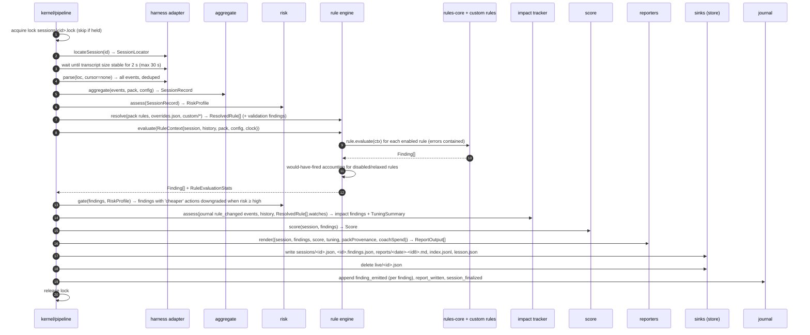

# Flows

How the components in [overview.md](overview.md) interact for each thing
Caddie does. Diagrams are Mermaid sequence diagrams; names match the component
sections in the overview. Hook names on the Claude Code side are the native
names; everything after the adapter is canonical (see
[harness-lifecycles.md](harness-lifecycles.md)).

Two rules hold in every flow:

1. **Hooks never block.** A hook handler does the minimum synchronous work the
   surface needs (read stdin, write small JSON) and defers anything heavier to
   a detached process. Any failure is logged and the hook exits 0.
2. **Everything Caddie does is journaled.** Each flow ends with a journal
   event, so the bundle and the impact tracker can replay what happened.

## 1. Session lifecycle (live)

What happens from the moment the harness starts to the moment the report
exists. Claude Code is the example harness.

```mermaid
sequenceDiagram
    autonumber
    participant H as Claude Code
    participant RH as run-hook.cmd
    participant CLI as caddie (hook handler)
    participant AD as adapter-claude-code
    participant K as kernel
    participant ST as store-fs (~/.caddie)
    participant FZ as caddie finalize (detached)

    H->>RH: SessionStart {session_id, transcript_path, source}
    RH->>CLI: node dist/caddie.cjs hook SessionStart
    CLI->>AD: mapHookInput(stdin) → session.start | session.resume | session.clear
    CLI->>K: onSessionStart(event)
    K->>ST: read lesson.json, config
    K->>ST: write live/<id>.json (empty LiveStats)
    K->>ST: journal lesson_injected
    K-->>CLI: Notification {audience: model, text: lesson}
    CLI-->>H: {"hookSpecificOutput": {"additionalContext": "<lesson ≤160 chars>"}}

    loop each turn
        H->>CLI: UserPromptSubmit {prompt}
        CLI->>K: onPrompt(prompt.submitted)   # heuristics only; text discarded
        K->>ST: journal prompt_heuristics
        CLI-->>H: {} or {"systemMessage": "<nudge>"}   # nudge decided from live stats
        H->>CLI: Stop {stop_hook_active}
        CLI->>AD: parse(transcript, cursor) → new events (dedup by requestId)
        AD-->>K: CaddieEvent[] + cursor
        K->>K: aggregate (incremental) → LiveStats
        K->>ST: write live/<id>.json
        CLI-->>H: {}   # async hook; output ignored
    end

    opt subagent
        H->>CLI: SubagentStop {agent_id, agent_transcript_path}
        CLI->>AD: parse subagent transcript → subagent.stop + nested events
        CLI->>K: aggregate (incremental)
    end

    opt compaction
        H->>CLI: PreCompact {trigger: auto|manual}
        CLI->>K: onCompactBefore → if idle > cacheTtl: Notification {audience: human}
        CLI-->>H: {"systemMessage": "⚠ cache is cold; this compaction re-writes the prefix"}
        H->>CLI: PostCompact
        CLI->>K: record compaction; reset prefix estimate
    end

    H->>CLI: SessionEnd {reason}
    CLI->>K: onSessionEnd → journal session_end
    CLI->>FZ: spawn detached `caddie finalize <id>` (stdio ignored, unref)
    CLI-->>H: {}   # returns in < 50 ms
    FZ->>FZ: see flow 2
```

Notes:

- Steps 3 to 9 are the only synchronous work on the critical path at start,
  and they read two small files. Budget: 300 ms including Node start-up.
- The `Stop` hook reads only the bytes appended since the stored cursor. If
  the transcript is large and the cursor is missing (first run after install),
  the handler reads at most the last 2 MB and marks live stats `partial`.
- Nudges in step 12 come from `LiveStats` computed at the previous `Stop`;
  they are one turn behind by design, which is fine for coaching.
- If `SessionEnd` never arrives (the harness crashed, the terminal was
  killed), flow 2 is still triggered by orphan catch-up: the next hook of any
  session, or any CLI command, finalizes live sessions whose transcript has
  not changed for longer than `thresholds.orphanAfterMinutes`.

## 2. Finalize pipeline

Runs detached after `session.end`, from `caddie finalize <id>`, and from
orphan catch-up. Idempotent: finalizing twice yields the same files.



Notes:

- Step 5 to 15 are pure given their inputs; the pipeline test replays a
  fixture transcript with a fake clock and asserts byte-identical outputs.
- The LLM coach (flow 7) slots between step 13 and 14 when enabled. It is
  the only step that can take more than a few seconds and the only one that
  spends money, so it runs last and cannot change the deterministic findings.
- The lesson chosen for `lesson.json` is the highest-severity finding with a
  lesson in the pack, excluding lessons shown in the last N sessions
  (`lesson.repeatAfterSessions`).

## 3. CLI report and summary over a time horizon

```mermaid
sequenceDiagram
    autonumber
    participant U as human or agent
    participant CLI as caddie report | summary
    participant ST as store
    participant IM as impact tracker
    participant RP as reporters

    U->>CLI: caddie report latest [--json|--md]
    CLI->>ST: read index.jsonl → latest id; read sessions/<id>.json, <id>.findings.json
    CLI->>RP: render(ReportInput) → stdout (json | markdown)
    CLI-->>U: report

    U->>CLI: caddie summary --since 7d [--json]
    CLI->>ST: read index.jsonl filtered by time; load SessionRecords
    CLI->>ST: read journal (rule_changed, config_changed, coach_spend) in window
    CLI->>IM: assess(history, changes) → TuningSummary
    CLI->>RP: renderSummary({sessions, findingsByRule, trends, tuning, coachSpend, packProvenance})
    CLI-->>U: totals, trends, top findings, "what your tuning did", coaching cost
```

Notes:

- Summaries are computed from stored `SessionRecord`s, never by re-parsing
  transcripts, so they work after the harness has deleted its own files.
- JSON output is the agent contract (flow 6) and is schema-versioned.

## 4. Rule override lifecycle

The user tunes a rule, Caddie applies it from the next session, measures the
side effects, and can undo it.

```mermaid
sequenceDiagram
    autonumber
    participant U as human
    participant CLI as caddie rules
    participant RE as rule engine
    participant ST as store
    participant J as journal
    participant P as pipeline (later sessions)
    participant IM as impact tracker

    U->>CLI: caddie rules set cache.low-hit-rate threshold=0.6
    CLI->>RE: validate against rule schema and defaults
    CLI->>ST: write rules/overrides.json {cache.low-hit-rate: {threshold: 0.6}}
    CLI->>J: append rule_changed {ruleId, before: {threshold: 0.75}, after: {threshold: 0.6}, watches: [cache.hitRate, cost.perSession]}
    CLI-->>U: "Applied. Caddie will report the effect on cache hit rate and cost after ≥5 sessions."

    loop each later finalize
        P->>RE: resolve → rule with threshold 0.6, provenance 'user-override'
        P->>RE: evaluate; also compute would-have-fired at the default 0.75
        P->>IM: assess(rule_changed events, history)
        IM-->>P: after ≥ minSamples: Finding config.rule-override-impact
    end

    Note over IM: "Since you relaxed cache.low-hit-rate (6 sessions ago): cache hit rate 84% → 71%, cost/session +18%. The default would have fired 4 times."

    U->>CLI: caddie rules reset cache.low-hit-rate
    CLI->>ST: remove entry from overrides.json
    CLI->>J: append rule_changed {before: {threshold: 0.6}, after: default}
    U->>CLI: caddie rules explain cache.low-hit-rate
    CLI-->>U: current value, provenance, defaults, watches, impact history, sources
```

Variants on the same flow:

- `caddie rules disable <id>` and `enable` are overrides with `enabled: false|true`; the impact tracker reports would-have-fired counts for disabled rules.
- `caddie rules snooze <id> --until 2026-12-01` is an override with `snoozeUntil`; it expires without a journal event, and the first evaluation after expiry journals `rule_changed {reason: snooze-expired}`.
- `caddie rules add <file.json>` validates a declarative custom rule and copies it to `rules/custom/`; `--allow-code` is required for `.cjs` files and also requires `rules.allowCode: true` in config.
- `caddie rules reset --all` restores defaults and journals one event per removed override.

## 5. Bundle creation and redaction

```mermaid
sequenceDiagram
    autonumber
    participant U as human
    participant CLI as caddie bundle
    participant B as kernel/bundle
    participant ST as store
    participant R as redactor
    participant J as journal

    U->>CLI: caddie bundle [--since 30d] [--include-reports] [--no-redact]
    CLI->>B: create(options)
    B->>ST: read sessions, findings, journal, config.json, rules/overrides.json, custom rules (names + hashes only), pack provenance, doctor output
    B->>R: redact(all documents) — paths → <path:hash8>, usernames, hostnames, prompt text (always, unless storePromptText and --no-redact)
    B->>ST: write bundles/<date>.tar.gz (temp + rename)
    B->>J: append bundle_created {path, counts, redacted: true}
    B-->>CLI: manifest {files[], sessionCount, dateRange, redactions applied, bytes}
    CLI-->>U: prints manifest and the path; "Review before sharing. Caddie never uploads."
```

Notes:

- Reports are excluded by default because Markdown reports can quote tool
  names and file paths in prose; with `--include-reports` they go through the
  same redactor.
- The bundle is the input format for `caddie eval import <bundle>`, which
  turns a dogfooding session into an eval scenario (the contributor labels
  the expectations by hand).

## 6. Agent consumption

An agent workflow (a CI job, a Claude Code skill, another harness) reads the
findings as data.

```mermaid
sequenceDiagram
    autonumber
    participant A as agent / CI job
    participant CLI as caddie
    participant RP as reporters (json)

    A->>CLI: caddie report latest --json
    CLI->>RP: render json
    CLI-->>A: {"findingsSchemaVersion": 1, "session": {...}, "findings": [{"id": "cache.cold-compaction", "severity": "warn", "evidence": {...}, "action": {...}, "confidence": 0.9, "source": "derived", "sources": ["https://..."]}], "score": {...}, "packProvenance": "..."}
    A->>A: branch on findings[].id / severity; e.g. post a comment, choose a cheaper model next time, or ignore
    A->>CLI: caddie summary --since 24h --json
    CLI-->>A: aggregate view with the same schema family
```

Contract points (`[ADR-0014 proposed]`): `findingsSchemaVersion` increments
only on breaking changes; new fields are additive; rule ids are stable
identifiers and renames ship with an alias for two minor versions; exit code
is 0 even when findings are severe (Caddie reports, it does not judge the
agent's run).

## 7. LLM coaching pass (M2, interface defined now)

```mermaid
sequenceDiagram
    autonumber
    participant P as pipeline
    participant C as kernel/coach
    participant BG as CoachBudget
    participant J as journal
    participant PR as LlmProvider (anthropic | claude-cli | noop)

    P->>C: coach(session, findings, config.llmCoach)
    C->>C: skip if disabled, or session cost < minSessionCostUsd, or trigger mismatch
    C->>BG: allow(estimateUsd) — windows from journal coach_spend events
    alt over budget and onExceeded = skip
        BG-->>C: {ok: false, reason}
        C->>J: append coach_skipped {reason}
    else over budget and onExceeded = downgrade
        BG-->>C: {ok: true, downgradeTo: cheaper model from pack}
    end
    C->>C: build redacted digest (no prompt text; rule ids, metrics, risk level)
    C->>PR: complete({model, system: promptVersion, input: digest, reasoning, maxOutputTokens})
    PR-->>C: {text, usage, model}
    C->>BG: record(usage, usd via pricing)
    C->>J: append coach_spend {model, usd, promptVersion, reasoning}
    C-->>P: Finding[] {category: coaching, confidence < 1, model, promptVersion}
```

## 8. Pack update and organisation packs

```mermaid
sequenceDiagram
    autonumber
    participant U as human / company admin
    participant CLI as caddie pack
    participant PK as kernel/pack
    participant PS as PackSource (file | url)
    participant ST as store
    participant J as journal

    U->>CLI: caddie pack import ./acme-pack.json | https://…/acme-pack.json
    CLI->>PS: fetch → document
    CLI->>PK: validate(document) → ok | findings
    CLI->>ST: write pack/org.json; config.pack.source = <origin>
    CLI->>J: append pack_loaded {layer: org, version, origin}
    U->>CLI: caddie pack set models.claude-opus-4-1.inputPerMTok 12.00
    CLI->>ST: write pack/overrides.json
    CLI->>J: append pack_changed {path, before, after}
    U->>CLI: caddie pack show | diff | export | reset
    CLI->>PK: resolve(shipped, org, overrides) → KnowledgePack + provenance
    CLI-->>U: resolved values with the layer each came from
```

`caddie pack update` checks the configured source for a newer version. In M1
it works against a path or URL without signature verification and says so;
signing lands with the auto-updater (`[ADR-0003]`).

## 9. Error paths that every flow shares

| Situation | Behaviour | Where tested |
|---|---|---|
| Hook throws | caught by `safeHook`, logged to `logs/hook.log`, journal `hook_error`, exit 0 with `{}` | hook integration |
| Node not on PATH | `run-hook.cmd` searches well-known locations, then logs and exits 0 | `run-hook.cmd` tests |
| Transcript missing or unreadable | empty events, `harness_event transcript_missing`, finding `config.no-transcript` once per session | adapter tests |
| Two finalizers race | lock file; the second exits silently | pipeline tests |
| Store write fails (disk full, permissions) | temp file discarded, journal `store_error` if the journal itself is writable, hook still exits 0 | store tests |
| Invalid override or custom rule | validation finding `config.rule-invalid`, rule skipped, other rules run | rule engine tests |
| Unknown model id | cost `null`, `costComplete: false`, finding `pack.unknown-model` with the id | pricing, aggregate tests |
| Pack source unreachable | previous org pack kept, finding `pack.update-failed` | pack tests |
| LLM provider error | no coaching finding, journal `coach_error`, report still written | coach tests |
