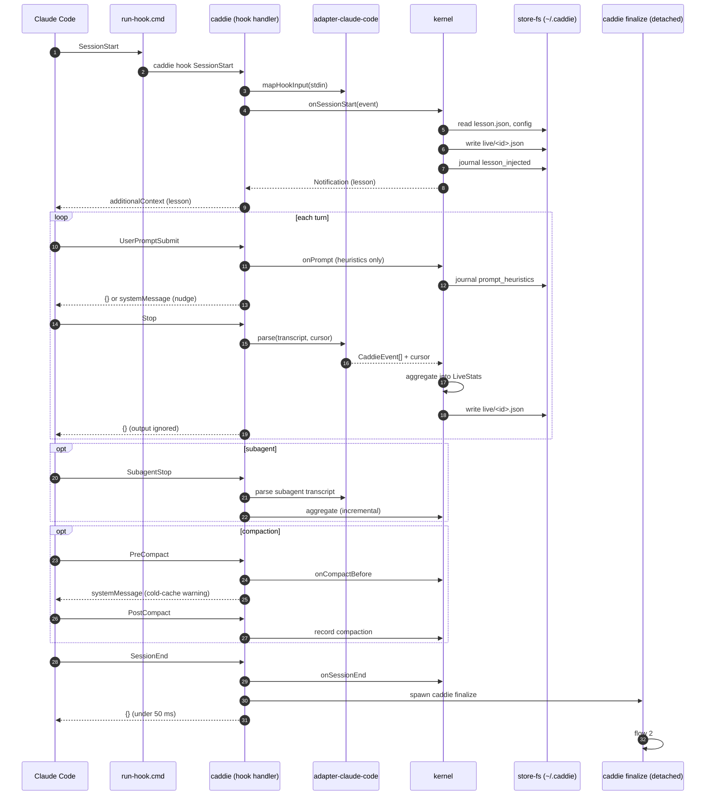
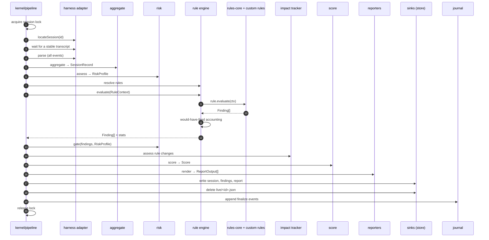
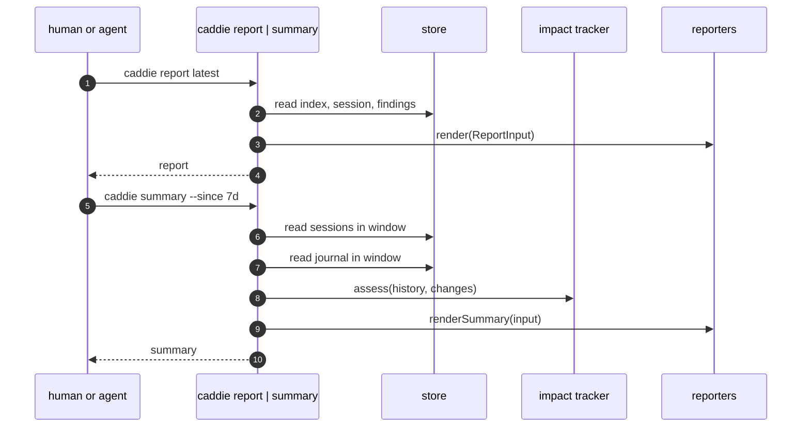
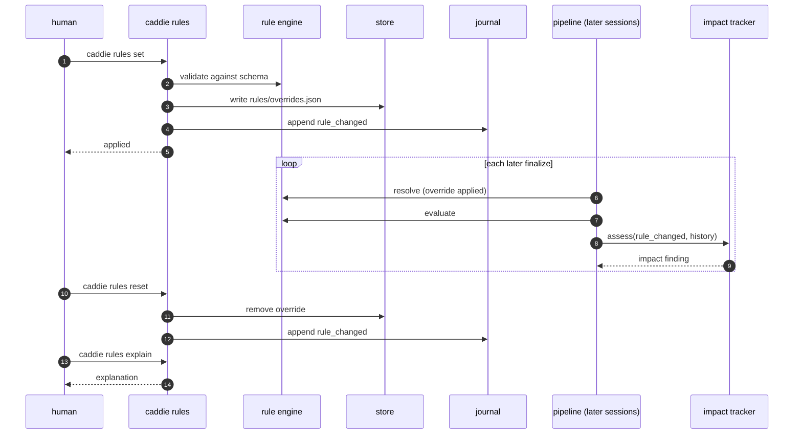
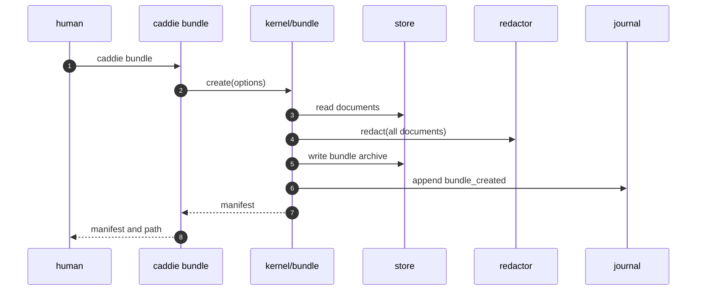
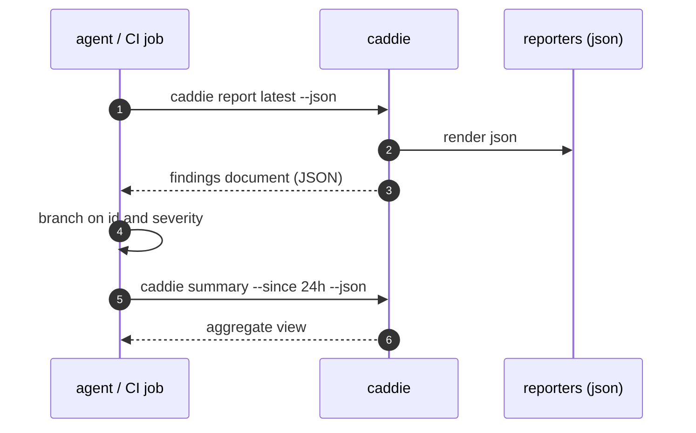
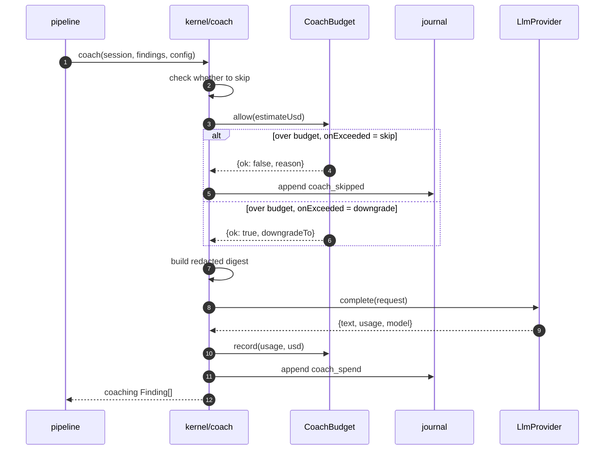
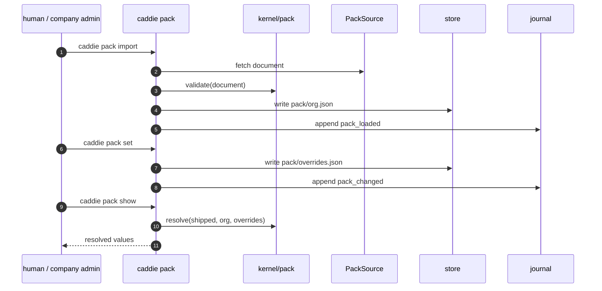

# Flows

How the components in [overview.md](overview.md) interact for each thing
Caddie does. Diagrams are Mermaid sequence diagrams; names match the component
sections in the overview. Arrow labels are kept short: the payloads, file
names and conditions for each numbered step are listed under its diagram. Hook names on the Claude Code side are the native
names; everything after the adapter is canonical (see
[harness-lifecycles.md](harness-lifecycles.md)).

Two rules hold in every flow:

1. **Hooks never block.** A hook handler does the minimum synchronous work the
   surface needs (read stdin, write small JSON) and defers anything heavier to
   a detached process. Any failure is logged and the hook exits 0.
2. **Everything Caddie does is journaled.** Each flow ends with a journal
   event, so the bundle and the impact tracker can replay what happened.

## 1. Session lifecycle (live)

What happens from the moment the harness starts to the moment the report
exists. Claude Code is the example harness.



Detail by step number:

- **1**: the payload carries `session_id`, `transcript_path` and `source`.
- **2**: `run-hook.cmd` runs `node dist/caddie.cjs hook SessionStart`.
- **3**: the adapter maps the payload to `session.start`, `session.resume`
  or `session.clear`.
- **6**: the file starts as an empty `LiveStats`.
- **8, 9**: the kernel returns `Notification {audience: model, text: lesson}`
  and the handler writes
  `{"hookSpecificOutput": {"additionalContext": "<lesson ≤160 chars>"}}`.
- **10, 11**: the event is `prompt.submitted`. Only heuristics are computed;
  the prompt text is discarded.
- **13**: `{}` or `{"systemMessage": "<nudge>"}`, decided from live stats.
- **14**: the payload carries `stop_hook_active`.
- **15**: returns the events appended since the cursor, deduplicated by
  `requestId`.
- **17**: aggregation is incremental.
- **19**: `Stop` is an async hook, so the harness ignores the output.
- **20, 21**: the payload carries `agent_id` and `agent_transcript_path`;
  parsing yields `subagent.stop` plus the nested events.
- **23 to 25**: the payload carries `trigger` (`auto` or `manual`). If the
  session has been idle for longer than `cacheTtl`, the kernel returns
  `Notification {audience: human}` and the handler writes
  `{"systemMessage": "⚠ cache is cold; this compaction re-writes the prefix"}`.
- **27**: also resets the prefix estimate.
- **28, 29**: the payload carries `reason`; the kernel journals
  `session_end`.
- **30**: `caddie finalize <id>`, detached, with stdio ignored and the child
  unreferenced.

Notes:

- Steps 3 to 9 are the only synchronous work on the critical path at start,
  and they read two small files. Budget: 300 ms including Node start-up.
- The `Stop` hook reads only the bytes appended since the stored cursor. If
  the transcript is large and the cursor is missing (first run after install),
  the handler reads at most the last 2 MB and marks live stats `partial`.
- Nudges in step 13 come from `LiveStats` computed at the previous `Stop`;
  they are one turn behind by design, which is fine for coaching.
- If `SessionEnd` never arrives (the harness crashed, the terminal was
  killed), flow 2 is still triggered by orphan catch-up: the next hook of any
  session, or any CLI command, finalizes live sessions whose transcript has
  not changed for longer than `thresholds.orphanAfterMinutes`.

## 2. Finalize pipeline

Runs detached after `session.end`, from `caddie finalize <id>`, and from
orphan catch-up. Idempotent: finalizing twice yields the same files.



Detail by step number:

- **1**: the lock is `sessions/<id>.lock`. If it is held, the pipeline
  exits.
- **2**: returns a `SessionLocator`.
- **3**: waits until the transcript size has been stable for 2 s, for at
  most 30 s.
- **4**: `parse(loc, cursor=none)` returns all events, deduplicated.
- **5**: `aggregate(events, pack, config)`.
- **6**: `assess(SessionRecord)`.
- **7**: `resolve(pack rules, overrides.json, custom/*)` returns
  `ResolvedRule[]` plus validation findings.
- **8**: `RuleContext{session, history, pack, config, clock}`.
- **9**: once for each enabled rule. An error in one rule is contained.
- **11**: for disabled and relaxed rules.
- **12**: the stats are `RuleEvaluationStats`.
- **13**: actions of kind `cheaper` are downgraded when risk is high or
  above.
- **14**: `assess(journal rule_changed events, history,
  ResolvedRule[].watches)` returns impact findings and a `TuningSummary`.
- **15**: `score(session, findings)`.
- **16**: `render({session, findings, score, tuning, packProvenance,
  coachSpend})`.
- **17**: writes `sessions/<id>.json`, `<id>.findings.json`,
  `reports/<date>-<id8>.md`, `index.jsonl` and `lesson.json`.
- **19**: appends `finding_emitted` for each finding, `report_written` and
  `session_finalized`.

Notes:

- Step 5 to 15 are pure given their inputs; the pipeline test replays a
  fixture transcript with a fake clock and asserts byte-identical outputs.
- The LLM coach (flow 7) slots between step 13 and 14 when enabled. It is
  the only step that can take more than a few seconds and the only one that
  spends money, so it runs last and cannot change the deterministic findings.
- The lesson chosen for `lesson.json` is the highest-severity finding with a
  lesson in the pack, excluding lessons shown in the last N sessions
  (`lesson.repeatAfterSessions`).

## 3. CLI report and summary over a time horizon



Detail by step number:

- **1**: accepts `--json` or `--md`.
- **2**: `index.jsonl` gives the latest id, then `sessions/<id>.json` and
  `<id>.findings.json` are read.
- **3**: writes JSON or Markdown to stdout.
- **5**: accepts `--json`.
- **6**: reads `index.jsonl` filtered by time and loads the matching
  `SessionRecord`s.
- **7**: reads the `rule_changed`, `config_changed` and `coach_spend`
  events.
- **8**: returns a `TuningSummary`.
- **9**: `renderSummary({sessions, findingsByRule, trends, tuning,
  coachSpend, packProvenance})`.
- **10**: totals, trends, top findings, "what your tuning did" and the
  coaching cost.

Notes:

- Summaries are computed from stored `SessionRecord`s, never by re-parsing
  transcripts, so they work after the harness has deleted its own files.
- JSON output is the agent contract (flow 6) and is schema-versioned.

## 4. Rule override lifecycle

The user tunes a rule, Caddie applies it from the next session, measures the
side effects, and can undo it.



Detail by step number:

- **1**: for example
  `caddie rules set cache.low-hit-rate threshold=0.6`.
- **2**: validates against the rule's schema and defaults.
- **3**: writes `{cache.low-hit-rate: {threshold: 0.6}}`.
- **4**: `rule_changed {ruleId, before: {threshold: 0.75}, after:
  {threshold: 0.6}, watches: [cache.hitRate, cost.perSession]}`.
- **5**: "Applied. Caddie will report the effect on cache hit rate and cost
  after ≥5 sessions."
- **6**: the rule resolves with threshold 0.6 and provenance
  `user-override`.
- **7**: also computes whether the rule would have fired at the default,
  0.75.
- **9**: once at least `minSamples` sessions exist, the finding
  `config.rule-override-impact`. For example: "Since you relaxed
  cache.low-hit-rate (6 sessions ago): cache hit rate 84% → 71%,
  cost/session +18%. The default would have fired 4 times."
- **10, 11**: `caddie rules reset cache.low-hit-rate` removes the entry
  from `overrides.json`.
- **12**: `rule_changed {before: {threshold: 0.6}, after: default}`.
- **13, 14**: `caddie rules explain cache.low-hit-rate` prints the current
  value, provenance, defaults, watches, impact history and sources.

Variants on the same flow:

- `caddie rules disable <id>` and `enable` are overrides with `enabled: false|true`; the impact tracker reports would-have-fired counts for disabled rules.
- `caddie rules snooze <id> --until 2026-12-01` is an override with `snoozeUntil`; it expires without a journal event, and the first evaluation after expiry journals `rule_changed {reason: snooze-expired}`.
- `caddie rules add <file.json>` validates a declarative custom rule and copies it to `rules/custom/`; `--allow-code` is required for `.cjs` files and also requires `rules.allowCode: true` in config.
- `caddie rules reset --all` restores defaults and journals one event per removed override.

## 5. Bundle creation and redaction



Detail by step number:

- **1**: options are `--since 30d`, `--include-reports` and `--no-redact`.
- **3**: reads sessions, findings, the journal, `config.json`,
  `rules/overrides.json`, custom rules (names and hashes only), pack
  provenance and doctor output.
- **4**: paths become `<path:hash8>`; usernames and hostnames are replaced.
  Prompt text is always removed, unless `storePromptText` is set and
  `--no-redact` is passed.
- **5**: writes `bundles/<date>.tar.gz` through a temporary file and a
  rename.
- **6**: `bundle_created {path, counts, redacted: true}`.
- **7**: `{files[], sessionCount, dateRange, redactions applied, bytes}`.
- **8**: prints the manifest and the path, then "Review before sharing.
  Caddie never uploads."

Notes:

- Reports are excluded by default because Markdown reports can quote tool
  names and file paths in prose; with `--include-reports` they go through the
  same redactor.
- The bundle is the input format for `caddie eval import <bundle>`, which
  turns a dogfooding session into an eval scenario (the contributor labels
  the expectations by hand).

## 6. Agent consumption

An agent workflow (a CI job, a Claude Code skill, another harness) reads the
findings as data.



Detail by step number:

- **4**: the agent branches on `findings[].id` and `severity`: for
  example it posts a comment, chooses a cheaper model next time, or does
  nothing.
- **6**: the aggregate view uses the same schema family.

The findings document returned in step 3 has this shape:

```json
{
  "findingsSchemaVersion": 1,
  "session": {},
  "findings": [
    {
      "id": "cache.cold-compaction",
      "severity": "warn",
      "evidence": {},
      "action": {},
      "confidence": 0.9,
      "source": "derived",
      "sources": ["https://..."]
    }
  ],
  "score": {},
  "packProvenance": "..."
}
```

Contract points (`[ADR-0014 proposed]`): `findingsSchemaVersion` increments
only on breaking changes; new fields are additive; rule ids are stable
identifiers and renames ship with an alias for two minor versions; exit code
is 0 even when findings are severe (Caddie reports, it does not judge the
agent's run).

## 7. LLM coaching pass (M2, interface defined now)



Detail by step number:

- **1**: the config is `config.llmCoach`.
- **2**: skips if coaching is disabled, the session cost is below
  `minSessionCostUsd`, or the trigger does not match.
- **3**: budget windows are computed from the journal's `coach_spend`
  events.
- **5**: `coach_skipped {reason}`.
- **6**: `downgradeTo` names a cheaper model from the pack.
- **7**: the digest holds rule ids, metrics and the risk level, and no
  prompt text.
- **8**: `complete({model, system: promptVersion, input: digest, reasoning,
  maxOutputTokens})`. Providers are `anthropic`, `claude-cli` and `noop`.
- **10**: the cost in USD comes from the pack's pricing.
- **11**: `coach_spend {model, usd, promptVersion, reasoning}`.
- **12**: `Finding[] {category: coaching, confidence < 1, model,
  promptVersion}`.

## 8. Pack update and organisation packs



Detail by step number:

- **1, 2**: the source is a file (`caddie pack import ./acme-pack.json`)
  or a URL (`https://…/acme-pack.json`).
- **3**: returns ok or findings.
- **4**: also sets `config.pack.source` to the origin.
- **5**: `pack_loaded {layer: org, version, origin}`.
- **6**: for example
  `caddie pack set models.claude-opus-4-1.inputPerMTok 12.00`.
- **8**: `pack_changed {path, before, after}`.
- **9**: `show`, `diff`, `export` and `reset` all resolve the pack first.
- **10**: returns the `KnowledgePack` and its provenance.
- **11**: each value is shown with the layer it came from.

`caddie pack update` checks the configured source for a newer version. In M1
it works against a path or URL without signature verification and says so;
signing lands with the auto-updater (`[ADR-0003]`).

## 9. Error paths that every flow shares

| Situation | Behaviour | Where tested |
|---|---|---|
| Hook throws | caught by `safeHook`, logged to `logs/hook.log`, journal `hook_error`, exit 0 with `{}` | hook integration |
| Node not on PATH | `run-hook.cmd` searches well-known locations, then logs and exits 0 | `run-hook.cmd` tests |
| Transcript missing or unreadable | empty events, `harness_event transcript_missing`, finding `config.no-transcript` once per session | adapter tests |
| Two finalizers race | lock file; the second exits silently | pipeline tests |
| Store write fails (disk full, permissions) | temp file discarded, journal `store_error` if the journal itself is writable, hook still exits 0 | store tests |
| Invalid override or custom rule | validation finding `config.rule-invalid`, rule skipped, other rules run | rule engine tests |
| Unknown model id | cost `null`, `costComplete: false`, finding `pack.unknown-model` with the id | pricing, aggregate tests |
| Pack source unreachable | previous org pack kept, finding `pack.update-failed` | pack tests |
| LLM provider error | no coaching finding, journal `coach_error`, report still written | coach tests |
